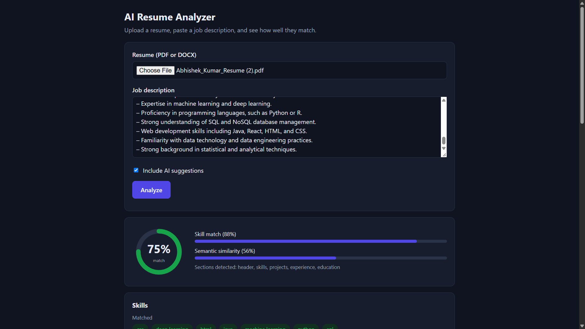
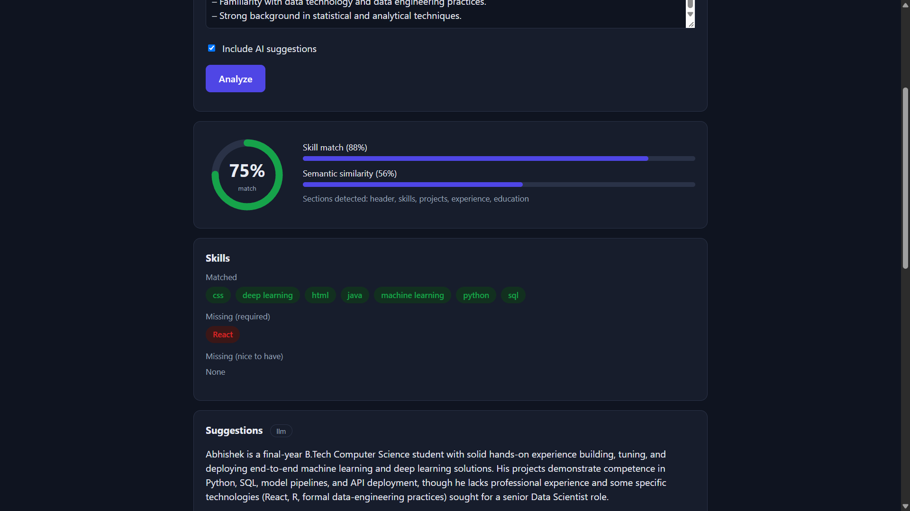
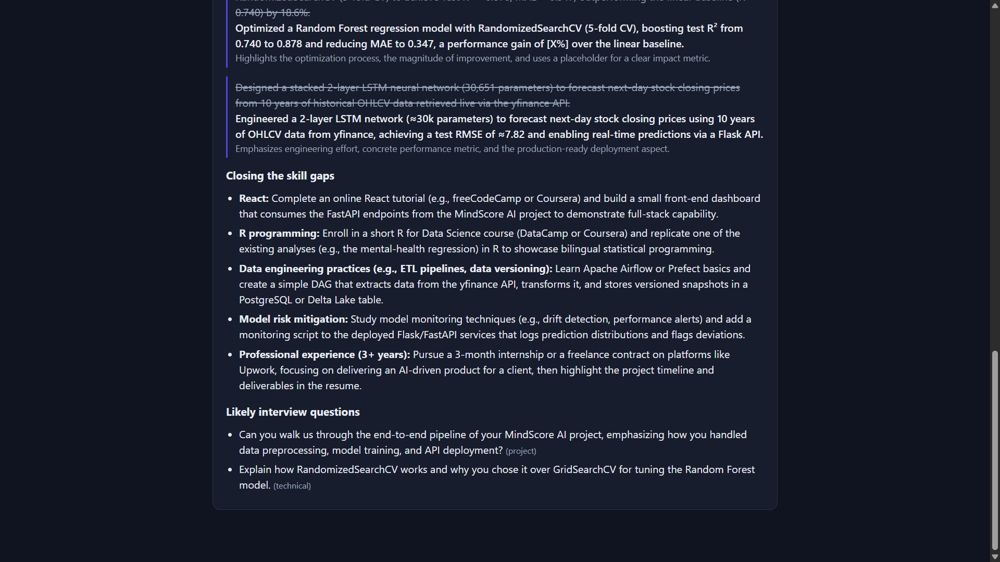
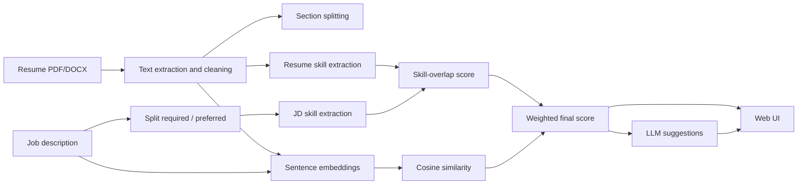

# AI Resume Analyzer & Job Matching System


An NLP-powered web app that compares a **resume** against a **job description** and tells you how well they match. It returns a compatibility score, the skills you already cover, the skills you are missing, and AI-written tips to improve your resume.

**Live demo:** `<add your Render link here>`





---

## Why this project

Applicant tracking systems and recruiters filter resumes quickly, and most candidates never learn why they were rejected. This project shows candidates, before they apply:

- how closely their resume fits a specific role,
- which required skills are missing,
- how to rewrite weak bullet points honestly, without inventing experience.

## Features

- **Resume parsing** for PDF and DOCX files, with text cleaning and section detection (skills, education, experience, projects)
- **Skill extraction** using a normalised skills dictionary, so "sklearn", "scikit-learn" and "scikit learn" all count as one skill
- **Required vs nice-to-have detection** in the job description, with different weights
- **Hybrid scoring** that combines exact skill matching with semantic similarity from sentence embeddings
- **Skill-gap report** showing matched, missing-required and missing-preferred skills
- **LLM suggestions** (via Groq): resume bullet rewrites, advice on closing skill gaps, and likely interview questions
- **Guardrails**: the LLM is instructed to use only facts from the resume and to use placeholders such as `[X%]` instead of inventing metrics
- **Graceful fallback**: if no API key is set or the LLM call fails, the app still returns the score plus rule-based tips
- **Web interface** built with plain HTML, CSS and JavaScript, served by the same FastAPI app

## How it works



### Scoring

**Skill score.** Required skills weigh 1.0 and nice-to-have skills weigh 0.5. A nice-to-have section is detected by markers such as "preferred", "nice to have" or "good to have".

```
skill_score = (1.0 x matched_required + 0.5 x matched_preferred)
              / (1.0 x total_required  + 0.5 x total_preferred)
```

**Semantic score.** The resume and the job description are embedded with `all-MiniLM-L6-v2` and compared with cosine similarity. This captures meaning that keyword matching misses, for example "built REST APIs" matching "backend development".

**Final score.**

```
compatibility = 0.6 x skill_score + 0.4 x semantic_score
```

The weights live in `app/scorer.py` (`WEIGHTS`) and can be tuned.

## Tech stack

| Layer | Tools |
|---|---|
| Backend | Python, FastAPI, Uvicorn |
| Parsing | PyMuPDF (PDF), python-docx (DOCX) |
| NLP | Dictionary-based skill extraction (regex), Sentence Transformers (`all-MiniLM-L6-v2`) |
| LLM | Groq API |
| Frontend | HTML, CSS, JavaScript |
| Testing | pytest |

## Project structure

```
resume-analyzer/
├── app/
│   ├── main.py        # FastAPI app and /analyze endpoint
│   ├── parser.py      # PDF/DOCX text extraction, cleaning, section splitting
│   ├── skills.py      # skill extraction with alias normalisation
│   ├── scorer.py      # skill score, semantic score, final score
│   └── llm.py         # LLM suggestions with rule-based fallback
├── data/
│   └── skills.json    # skills dictionary with aliases
├── static/
│   ├── index.html
│   ├── style.css
│   └── script.js
├── tests/             # unit tests
├── docs/              # screenshots
├── requirements.txt
└── README.md
```

## Getting started

### Prerequisites

- Python 3.10 or newer
- A [Groq API key](https://console.groq.com) (optional; without it the app uses rule-based suggestions)

### Installation

```bash
git clone https://github.com/Abhishek-995312/ai-resume-analyzer.git
cd ai-resume-analyzer

python -m venv .venv
# Windows
.venv\Scripts\activate
# macOS / Linux
source .venv/bin/activate

pip install -r requirements.txt
```

### Configuration

Create a `.env` file in the project root:

```
GROQ_API_KEY=your_key_here
LLM_MODEL=openai/gpt-oss-120b
```

| Variable | Required | Description |
|---|---|---|
| `GROQ_API_KEY` | No | Enables LLM suggestions. Without it, rule-based tips are returned. |
| `LLM_MODEL` | No | Groq model name. Defaults to `openai/gpt-oss-120b`. |

Never commit your `.env` file. It is listed in `.gitignore`.

### Run

```bash
uvicorn app.main:app --reload
```

Open `http://127.0.0.1:8000`. The first analysis is slow because the embedding model (about 90 MB) is downloaded once.

### Run the tests

```bash
pytest
```

## API

| Method | Endpoint | Description |
|---|---|---|
| `GET` | `/` | Web interface |
| `GET` | `/health` | Health check |
| `POST` | `/analyze` | Analyze a resume against a job description |

`POST /analyze` accepts `multipart/form-data`:

| Field | Type | Description |
|---|---|---|
| `resume` | file | PDF or DOCX |
| `jd_text` | string | Job description text |
| `include_suggestions` | boolean | Default `true` |

Example:

```bash
curl -X POST http://127.0.0.1:8000/analyze \
  -F "resume=@my_resume.pdf" \
  -F "jd_text=Required: Python, SQL, machine learning. Nice to have: Docker." \
  -F "include_suggestions=true"
```

Example response (shortened, values are illustrative):

```json
{
  "compatibility_percent": 58.4,
  "skill_score": 0.667,
  "semantic_score": 0.45,
  "matched_skills": ["python", "sql"],
  "missing_required": ["machine learning"],
  "missing_preferred": ["docker"],
  "sections_found": ["header", "skills", "projects"],
  "suggestions": {
    "summary": "...",
    "bullet_rewrites": [{ "original": "...", "improved": "...", "why": "..." }],
    "skill_gap_advice": [{ "skill": "machine learning", "how_to_address": "..." }],
    "interview_questions": [{ "question": "...", "type": "technical" }],
    "source": "llm"
  }
}
```

Interactive API docs are available at `/docs`.

## Deployment (Render)

1. Push the repository to GitHub.
2. Create a new **Web Service** on Render and connect the repo.
3. Set the build command to `pip install -r requirements.txt`.
4. Set the start command to `uvicorn app.main:app --host 0.0.0.0 --port $PORT`.
5. Add `GROQ_API_KEY` (and optionally `LLM_MODEL`) under **Environment**.

PyTorch and the embedding model need a fair amount of memory. If the service restarts on a small instance, use a larger plan.

## Limitations

- **Skill coverage** depends on `data/skills.json`. Skills that are not in the dictionary are not detected, so extend the file for your target roles.
- **Layout-heavy PDFs** (multi-column designs, text inside images) may extract in the wrong order or not at all. Scanned PDFs are not supported because there is no OCR step.
- **The semantic score is not calibrated.** Raw embedding similarity between a resume and a job description tends to sit in a narrow mid range, so treat the final percentage as a relative guide, not an absolute grade.
- **LLM output can be imperfect.** Review rewrites before using them, especially any numbers. Placeholders like `[X%]` are meant to be filled with your real figures.
- **Not a hiring decision.** The score is an estimate to help candidates improve their resumes.

## Privacy

- Uploaded resumes are read and processed in memory and are not saved by the application.
- When AI suggestions are enabled, the resume text and job description are sent to the Groq API. Untick "Include AI suggestions" to keep everything local.
- Avoid uploading resumes that contain information you do not want to share with a third-party service.

## Roadmap

- [ ] Job ranking: recommend the top matching jobs from a collection of job descriptions
- [ ] Evaluation on a hand-labeled set of resume and job description pairs, and weight tuning based on the results
- [ ] Calibration of the semantic score
- [ ] OCR support for scanned resumes
- [ ] Larger skills taxonomy (for example from ESCO or O*NET)

## Author

**`Abhishek Kumar`**
GitHub: [`https://github.com/Abhishek-995312`](https://github.com/<your-username>) · LinkedIn: `https://www.linkedin.com/in/abhishek-kumar-a2848b416/`

## Acknowledgements

- [FastAPI](https://fastapi.tiangolo.com/)
- [Sentence Transformers](https://www.sbert.net/)
- [PyMuPDF](https://pymupdf.readthedocs.io/)
- [Groq](https://groq.com/)
